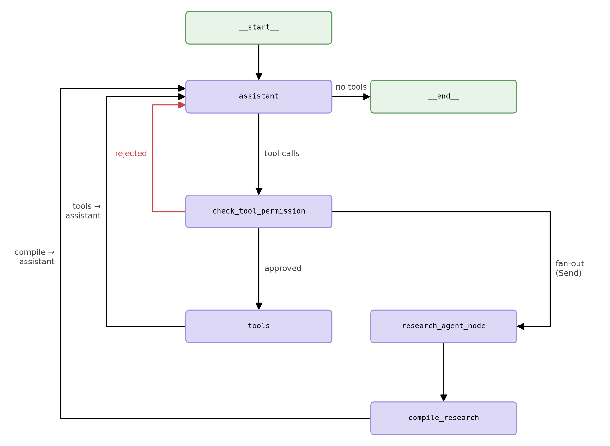

# ReAct Orchestrator

A [LangGraph](https://github.com/langchain-ai/langgraph)-based agent harness built around a **ReAct loop with human-in-the-loop tool approval** and a reusable **fan-out/fan-in orchestration pattern** for parallel sub-agent task execution.

The repository currently implements a parallel internet research workflow, where an orchestrator delegates independent research tasks to concurrent worker agents before synthesizing and aggregating the results back to the orchestrating agent. The underlying orchestration layer is workflow-agnostic and can be extended with additional worker types and virtual tools while reusing the existing routing, approval, and aggregation mechanisms.

The agent is equipped with a toolbox for file-system navigation, content and context discovery, and writing workflows, enabling it to explore local files and directories, gather supporting information, and produce artifacts as part of larger agent-driven tasks.

The architecture is provider-agnostic: the LLM backend (currently TogetherAI) and web search client (currently Tavily) can be swapped with minimal code changes.


## Architecture



The graph has two distinct execution paths:

**Main loop** — `assistant → check_tool_permission → tools → assistant`  
The `assistant` node streams the LLM response. If the model emits a tool call, execution moves to `check_tool_permission`, which can interrupt and prompt the user for approval before proceeding. Rejected calls inject a `ToolMessage` denial back into the message history and return to `assistant`. Approved standard tool calls are handled by LangGraph's `ToolNode` and the result is fed back to `assistant`.

**Research fan-out** — `check_tool_permission → research_agent_node(s) → compile_research → assistant`  
When the model calls `parallel_internet_research_agent`, `check_tool_permission` detects the virtual tool and uses LangGraph `Send` to dispatch one research sub-agent via `research_agent_node` per query in parallel. Each worker runs its own internet research and synthesizes the results with a dedicated LLM call. `compile_research` joins all branches, packages the results as a single `ToolMessage`, resets the intermediate research state, and hands control back to `assistant`.

`compile_research` also sets a `research_report_pending_write` flag. On the following `assistant` turn, a dedicated report-writing LLM call receives a research system prompt, the latest user request, the dispatched research queries, and the compiled findings. This focused context avoids resending the entire conversation history. The writer has no tools and is instructed to synthesize only the supplied findings into a short summary followed by a full markdown report, separated by a `===REPORT===` delimiter. The full report is written straight to `RESEARCH_REPORTS_DIR` — no extra tool-call round trip — and the large compiled-research `ToolMessage` is replaced in place (same message id, so LangGraph's `add_messages` overwrites it rather than appending a duplicate) with just the short summary. Only that summary persists in the conversation's message history going forward, so a long session doesn't keep re-paying token cost for the full research text on every subsequent turn.

If the report writer returns empty content, no report file is written and a failure message is returned to the conversation. If it reaches its token limit, a warning is logged because the saved report may be truncated. If the delimiter is missing, the full response is saved as the report and its first paragraph is used as the summary.

For a more detailed, interactive walkthrough of both paths, open `docs/flows.html` in a browser — a standalone visualizer (data sourced from `docs/flows.json`) that illustrates the graph's execution flows step by step.

### Nodes

| Node | Role |
|------|------|
| `assistant` | Main ReAct LLM node; streams tokens and may emit tool calls |
| `check_tool_permission` | Human-in-the-loop gate; interrupts for approval when enabled |
| `tools` | LangGraph `ToolNode`; executes all standard (non-virtual) tools |
| `research_agent_node` | Parallel worker; runs one search query and synthesizes results |
| `compile_research` | Joins fan-out branches into a single tool response |

`assistant` also handles the research-report synthesis step described above: when `research_report_pending_write` is set, it produces the summary/report pair and writes the file itself instead of its normal streaming pass.

## Tools

### Internet research

| Tool | Description |
|------|-------------|
| `internet_research` | Single web search; expects a full natural-language query |
| `parallel_internet_research_agent` | Virtual tool intercepted by the router to trigger the fan-out pattern across multiple independent queries |

### File navigation & context

| Tool | Description |
|------|-------------|
| `get_working_directory` | Return the current working directory |
| `change_directory` | Change the working directory |
| `list_directory` | List entries in a directory |
| `list_files_recursive` | Recursively list files matching a glob pattern |
| `path_exists` | Check whether a path exists |
| `is_directory` / `is_file` | Type checks for a path |
| `get_absolute_path` | Resolve a path to its absolute form |
| `make_directory` | Create a directory tree |
| `get_file_size` | Return file size in bytes |
| `find_file_in_directory` | Non-recursive filename search with optional fuzzy matching |
| `find_file_in_directory_or_subdirectories` | Recursive filename search with optional fuzzy matching |
| `search_file_contents` | Keyword/phrase search within a file with context lines |
| `get_file_contents` | Read a file's text content (truncated to ~1000 tokens) |
| `get_full_directory_information` | Metadata (size, modified time, type) for all entries in a directory |
| `write_markdown_file` | Write markdown content to a timestamped file |

### Skills

| Tool | Description |
|------|-------------|
| `load_skill` | Load the full instructions from a skill's `SKILL.md`, using its exact name from the available skills list |

## Skills

Skills provide reusable instructions for specific activities. Set `SKILLS_DIR` to the directory containing your skill folders; the default configuration example uses `skills/`. Each skill should be a direct child directory whose name matches the `name` in its YAML frontmatter:

```text
skills/
└── research-review/
    └── SKILL.md
```

A `SKILL.md` must begin with YAML frontmatter containing `name` and `description`, followed by the instructions:

```markdown
---
name: research-review
description: Review a research report for evidence gaps and unsupported claims.
---

Read the report, identify claims that lack supporting evidence, and explain
what additional research would resolve each gap.
```

At CLI startup, `skills_reader.py` discovers `SKILL.md` files under `SKILLS_DIR` and adds their names and descriptions to the default system prompt. The agent is instructed to match skills to the activity requested, respect description exclusions, and call `load_skill` before starting matching work. The tool reads `SKILLS_DIR/<skill-name>/SKILL.md` and returns the instructions after the frontmatter. Those instructions remain in conversation context, so the agent is instructed to load each skill once per conversation.

Use direct child folders as shown above: discovery is recursive, but `load_skill` resolves skills by name directly beneath `SKILLS_DIR`. Restart the CLI after adding or changing skill descriptions. A custom `system_prompt` passed to `main()` replaces the default prompt, including its skills list and loading guidance.

The repository tracks `skills/.gitkeep` to preserve the directory; local skill contents are excluded by `.gitignore`. You can leave the directory empty, but `SKILLS_DIR` must still be configured.

## Logging

Logs and research reports are written at runtime (paths configured in `.env`):

- **`SEARCH_LOGS`** — JSONL of every search request and response, tagged `single` or `multiple` depending on which tool triggered the search
- **`AGENT_RESPONSE_LOGS`** — JSONL of full conversation message histories, written on clean exit
- **`GENERAL_LOGS`** — Standard Python `logging` output (`general_log.log`) for node-level debug/info events, level set via `LOGGING_LEVEL`
- **`RESEARCH_REPORTS_DIR`** — Full markdown research reports synthesized after a `parallel_internet_research_agent` fan-out; only a short summary of each report is kept in the live conversation history

Log paths are excluded from version control via `.gitignore`.

## Telemetry & observability

When `USE_TELEMETRY=y`, `main.py` calls `setup_file_telemetry()` (`telemetry.py`) at startup, which:

- Tags every span for the process run with a shared `session.id` resource attribute (one UUID per run, so multi-turn conversations group back into a single session)
- Writes spans to two local files under `logs/telemetry/` via OpenTelemetry's `BatchSpanProcessor`, so tracing never blocks the LangGraph event loop:
  - **`traces.json`** — pretty-printed spans (`ConsoleSpanExporter` default formatting)
  - **`jsonl_traces.jsonl`** — one JSON span per line, the format the upload step consumes

Traces are captured locally first and pushed to [LangSmith](https://smith.langchain.com/) as a separate, explicit step rather than exported live:

```bash
uv run python utils/upload_traces.py
```

This reads `jsonl_traces.jsonl`, remaps trace/span IDs to fresh values (LangSmith permanently rejects re-sent IDs, even after the owning run is deleted), and POSTs the batch to LangSmith's OTLP ingestion endpoint using `LANGSMITH_API_KEY` (and `LANGSMITH_PROJECT`, if set). It tracks how far it has already uploaded in `logs/telemetry/jsonl_traces.uploaded_offset`, so re-running the script only sends new spans — safe to run repeatedly, e.g. after each session.

## Setup

Requires Python ≥ 3.12 and [`uv`](https://github.com/astral-sh/uv).

```bash
git clone <repo>
cd general_agent_orchestrator
uv sync
cp .env.example .env   # then fill in your values
```

### Environment variables

Copy `.env.example` to `.env` in the project root and fill in the provider keys and model. Settings are loaded from this file with Pydantic Settings; environment variables can override its values. Both `RESEARCH_REPORTS_DIR` and `SKILLS_DIR` are required settings. Relative paths are resolved from the working directory, so run the CLI from the project root when using the paths below:

```dotenv
# LLM provider (TogetherAI by default — swap in any LangChain chat model)
TOGETHER_API_KEY=your_together_key
LLM_MODEL=MiniMaxAI/MiniMax-M2.7
LLM_MAX_TOKENS=8192

# Web search (Tavily by default — swap in any search client)
WEBSEARCH_API_KEY=your_tavily_key

# Tool approval: 'y' prompts before every tool call; 'n' approves automatically.
# PARALLEL_TOOL_CALLS controls whether the LLM may emit multiple tool calls
# in a single response. Keep this 'n' — it is incompatible with per-call
# approval prompts and is unnecessary: the parallel_internet_research_agent
# fan-out runs concurrently via LangGraph Send regardless of this setting.
ASK_TOOL_PERMISSIONS=y
PARALLEL_TOOL_CALLS=n

# Log destinations (relative or absolute paths)
SEARCH_LOGS=logs/search
AGENT_RESPONSE_LOGS=logs/chat_traces
GENERAL_LOGS=logs/general_logs

# Where full synthesized research reports are written (see Architecture)
RESEARCH_REPORTS_DIR=logs/research_reports

# Skill folders containing SKILL.md files (required even if no skills are installed)
SKILLS_DIR=skills

# Python logging level: DEBUG | INFO | WARNING | ERROR | CRITICAL
LOGGING_LEVEL=WARNING

# Telemetry: set to 'y' to write OTel spans to logs/telemetry/ during the run
USE_TELEMETRY=y

# Only needed to run utils/upload_traces.py and push local spans to LangSmith
LANGSMITH_API_KEY=your_langsmith_key
LANGSMITH_PROJECT=your_langsmith_project
```

## Running

```bash
uv run react-orchestrator
```

Enter a single-line prompt at `prompt>`, or use the commands below for longer input. Commands work for both the first prompt and follow-up turns.

| Command | Behavior |
|---------|----------|
| `!multiline` | Start collecting a prompt across multiple lines, preserving line breaks |
| `!send` | Submit the collected prompt when entered on its own line in multiline mode |
| `!cancel` | Discard the draft and return to the prompt when entered on its own line in multiline mode |
| `!paste` | Read and submit the current macOS clipboard text using `pbpaste` |
| `!exit` | End the session and flush conversation history to the response log |

`!paste` requires macOS's `pbpaste` command. Multiline input works across platforms. Blank input and cancelled or empty drafts are skipped without invoking the agent. Tool-approval prompts still accept their normal approval responses.

For example:

```text
prompt>!multiline
Compare these research questions:
1. What evidence supports the claim?
2. What uncertainties remain?
!send
```

On first run the agent graph diagram is rendered and saved to `docs/agent_graph.png`.

## Swapping providers

**LLM** — replace the `ChatTogether` instances in `nodes.py` with any LangChain-compatible chat model (e.g. `ChatOpenAI`, `ChatAnthropic`, `ChatOllama`) and update the relevant `*_API_KEY` variable.

**Web search** — replace the `TavilyClient` calls in `agent_tools.py` and `nodes.py` with any search client (e.g. Firecrawl, Brave Search, SerpAPI). The contract is: accept a query string, return a list of results with a `content` field.

## Project structure

```
src/react_orchestrator/
├── main.py          # Entry point, REPL loop, session cleanup
├── graph.py         # LangGraph graph definition and compilation
├── nodes.py         # All node and conditional-edge functions
├── agent_tools.py   # Tool definitions and registries
├── prompts.py       # Central source for system/tool prompt strings
├── state.py         # AgentState schema and custom reducers
├── settings.py      # Pydantic settings loaded from .env
├── skills_reader.py # Discovers SKILL.md frontmatter for the skills list
├── agent_logger.py  # Logging configuration
└── telemetry.py     # OTel setup: writes spans to logs/telemetry/

skills/
├── .gitkeep         # Keeps the empty directory in version control
└── <skill-name>/    # Local skill folders (gitignored)
    └── SKILL.md     # YAML name/description followed by full instructions

.env.example        # Configuration template, including report and skill paths

utils/
├── draw_correct_flow.py   # Generates docs/agent_graph.png
└── upload_traces.py       # Pushes logs/telemetry/jsonl_traces.jsonl to LangSmith

docs/
├── agent_graph.png  # Rendered LangGraph diagram (see `Running`)
├── flows.html       # Standalone interactive flow visualizer (see `Architecture`)
└── flows.json       # Flow data backing flows.html
```
